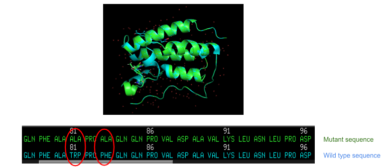
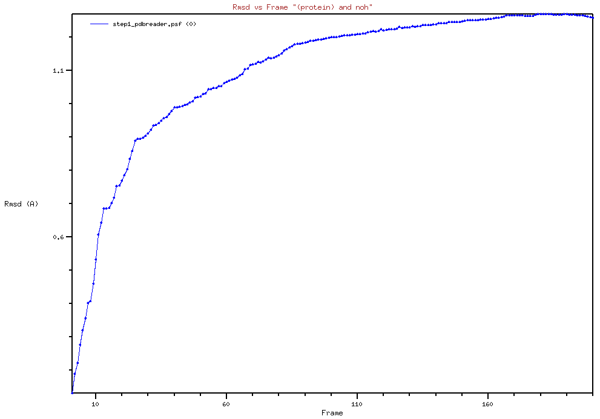
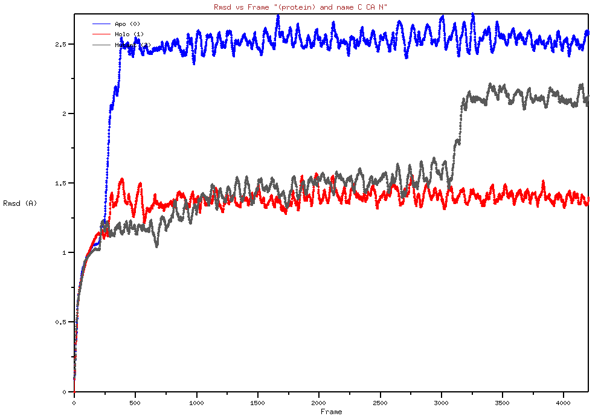
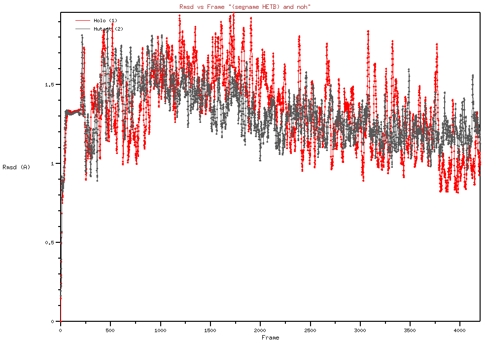

# BRD4 Bromodomain Molecular Dynamics: Effect of the W81A/F83A Mutations on LSH24 Binding

Short molecular dynamics (MD) study of the first bromodomain of human BRD4 (BD1) in three states:
**apo**, **holo** (bound to the dual BET–HDAC inhibitor LSH24) and a **W81A/F83A mutant** (holo).
The question: how does removing two binding-pocket aromatic residues change protein dynamics and
ligand stability?

> Coursework: *Molecular Modelling* practical, École supérieure de biotechnologie de Strasbourg
> (ESBS), Université de Strasbourg. Supervisors: Annick Dejaegere, Roland Stote, Meilin An.
> Authors: Daniel Ogundero and Minka Schwengelbeck.

## Background

BRD4 is a BET-family "epigenetic reader": its bromodomains bind acetylated lysines on histones, and
it is a drug target in cancer. Trp81–Pro82–Phe83 form a hydrophobic ledge (the "WPF shelf") along
the acetyl-lysine pocket; here Trp81 and Phe83 are replaced by alanine. The ligand LSH24 (residue
name `S7T`) comes from the 7AXR crystal structure (reference 1).

## Systems

| System | Protein | Ligand | Coordinates |
|---|---|---|---|
| Apo | BRD4 BD1, chain A (res. 42–168) | none | PDB 7AXR, protein only |
| Holo | same | LSH24 (`S7T`), one copy (`HETB`) | PDB 7AXR |
| Mutant | same, W81A + F83A | LSH24 (`S7T`), one copy (`HETB`) | provided by the course instructors |

7AXR contains two copies of LSH24 (`HETA`, `HETB`); only `HETB` was simulated.

## Methods

1. **Mutation identification**: wild-type and mutant structures superimposed and compared in
   PyMOL: Trp81→Ala and Phe83→Ala (Fig. 1). The script in `analysis/` repeats this on a mutant
   model regenerated from 7AXR with PyMOL's Mutagenesis Wizard, because the instructors' files are
   not redistributed. That model demonstrates the method; it is not the structure that was
   simulated.
2. **System building**: CHARMM-GUI *PDB Reader*: topology and coordinates with the CHARMM36m
   protein force field; ligand parameters from CGenFF through CHARMM-GUI (a first approximation).
   No water or ions were added.
3. **Minimization**: 10,000 steps in NAMD, to remove steric clashes before dynamics.
4. **MD**: 200,000 steps of 1 fs (200 ps) in NAMD, in vacuum, initial velocities at 298 K.
5. **Analysis**: backbone and ligand RMSD and visual inspection in VMD.

| Setting | Value | Basis |
|---|---|---|
| Minimization | 10,000 steps, all systems | ≈4,200 frames in Figs. 3 and 5; apo log |
| MD | 200,000 steps × 1 fs = 200 ps | report; NAMD configuration |
| Frame interval | 50 steps (0.05 ps) | ≈4,200 frames = 201 + 4,000 |
| Environment | vacuum, no periodic boundaries, no thermostat (constant energy), cutoff 10 Å | NAMD configuration of the author's own holo re-run (VMD NAMDgui defaults); assumed identical for the runs behind the figures |

## Results

*(Values are read from the plots and approximate. RMSD = backbone N/CA/C atoms. Frame numbers
are indices in the loaded trajectory, which starts with ≈200 minimization frames; at 0.05 ps per
frame, frame 3100 ≈ 145 ps of MD and frame 350 ≈ 7.5 ps.)*

**Apo vs holo.** The apo protein rises to ≈2.5 Å RMSD shortly after the start of MD and stays
there, whereas holo stays around 1.3–1.5 Å (Fig. 3). In this run, ligand binding is associated
with a more stable bromodomain fold.

**Mutant vs holo.** The mutant tracks holo until frame ~3100, then steps up to ≈2.1 Å (Fig. 3),
with a localized rearrangement visible in VMD (Fig. 4).

**Ligand.** LSH24 RMSD stays between ≈0.9 and 1.9 Å in holo and mutant, with no obvious
difference (Fig. 5), and the ligand is still in the pocket at the end of both runs (Fig. 6).


*Fig. 1 — Wild-type and mutant BRD4 superimposed in PyMOL; sequence strip shows Trp81→Ala and
Phe83→Ala.*


*Fig. 2 — RMSD during minimization (mutant).*


*Fig. 3 — Backbone RMSD of apo (blue), holo (red) and mutant (gray).*


*Fig. 4 — Mutant at two frames; the arrow marks the rearranged region.*


*Fig. 5 — LSH24 (`HETB`) RMSD, holo (red) vs mutant (gray).*


*Fig. 6 — Holo and mutant overlaid, beginning vs end of the trajectory.*

## Interpretation and limitations

- In this single vacuum trajectory, the bound ligand stabilizes the bromodomain relative to apo;
  part of the apo drift may be a vacuum effect (no solvent screening).
- W81A/F83A leaves ligand retention essentially unchanged but is followed by a late, localized
  conformational change. With one run per system, that change cannot be attributed to the
  mutation.
- 200 ps in vacuum without temperature control describes an isolated protein, not a protein in
  water at 298 K.
- CGenFF flags one ligand torsion with a penalty of 68 (above 50 = poor analogy).
- RMSD reports positional stability, not binding affinity; no free-energy estimate was made.

## What is and is not included

| Item | Status |
|---|---|
| Report (PDF) and Figures 1–6 | included |
| CHARMM-GUI topologies for apo and holo, LSH24 parameters | included (author's builds, February 2026) |
| NAMD configuration, holo | included — author's own re-run, which used a 1,000-step minimization; the runs behind the figures used 10,000 |
| Runs behind the figures (NAMD configs, logs, trajectories) | not available |
| Mutant simulation files | not included (provided by the instructors) |
| RMSD scripts | not available (analysis done interactively in VMD) |
| Regenerated mutant model + PyMOL script (Fig. 1) | included |

## Repository layout

```
.
├── README.md
├── .gitignore
├── report/        # BRD4_MD_report.pdf
├── figures/       # fig1 … fig6 (PNG)
├── analysis/      # fig1_mutation.pml, mutant_model_W81A_F83A.pdb
└── setup/
    ├── apo/       # step1_pdbreader.psf / .pdb / .inp
    ├── holo/      # step1_pdbreader.psf / .pdb / .inp / .namd
    └── ligand/    # s7t.rtf, s7t.prm (CGenFF)
```

## References

1. Schaker-Hübner L. *et al.* 4-Acyl pyrrole capped HDAC inhibitors: a new scaffold for hybrid
   inhibitors of BET proteins and histone deacetylases as antileukemia drug leads.
   *J. Med. Chem.* **2021**, 64, 14620–14646. doi:10.1021/acs.jmedchem.1c01119 (PDB 7AXR)
2. Jo S. *et al.* CHARMM-GUI: a web-based graphical user interface for CHARMM.
   *J. Comput. Chem.* **2008**, 29, 1859–1865.
3. Huang J. *et al.* CHARMM36m: an improved force field for folded and intrinsically disordered
   proteins. *Nat. Methods* **2017**, 14, 71–73.
4. Vanommeslaeghe K. *et al.* CHARMM general force field. *J. Comput. Chem.* **2010**, 31, 671–690.
5. Phillips J. C. *et al.* Scalable molecular dynamics on CPU and GPU architectures with NAMD.
   *J. Chem. Phys.* **2020**, 153, 044130.
6. Humphrey W., Dalke A., Schulten K. VMD: visual molecular dynamics.
   *J. Mol. Graph.* **1996**, 14, 33–38.
